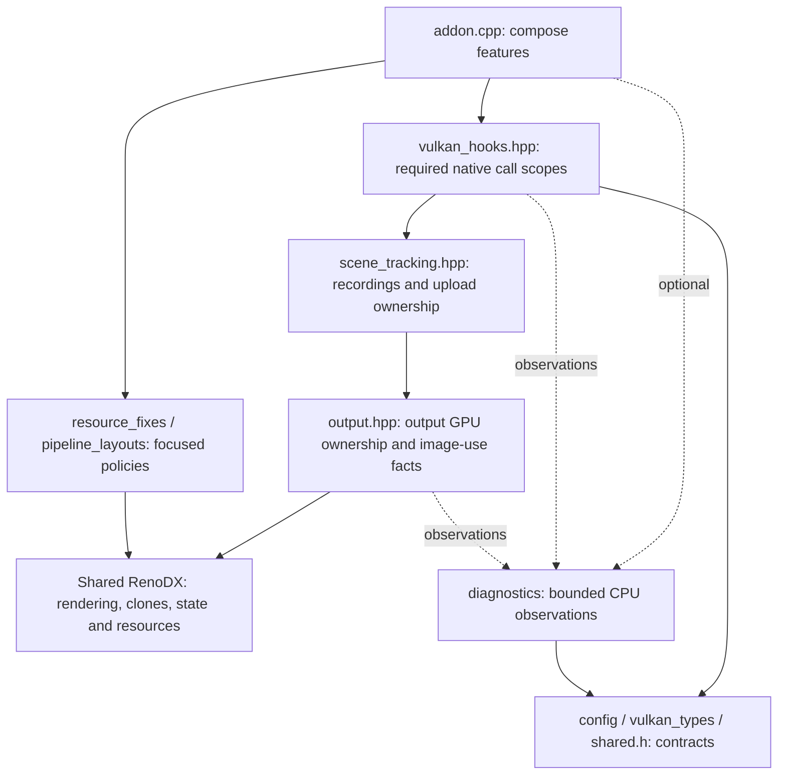
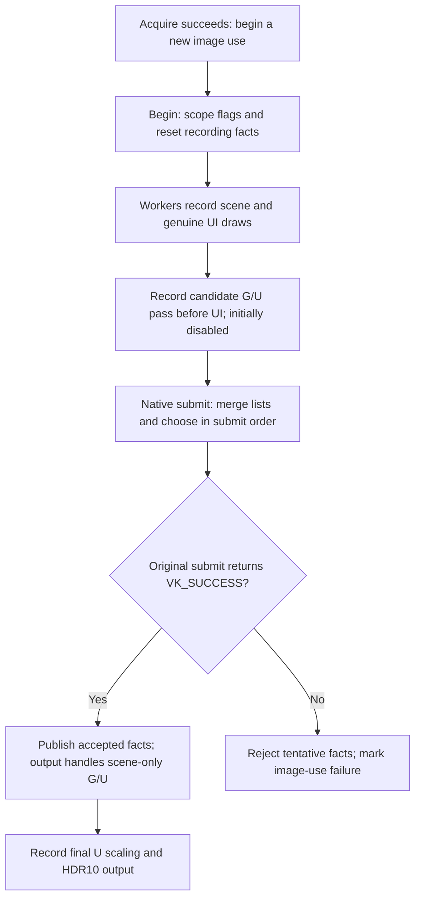
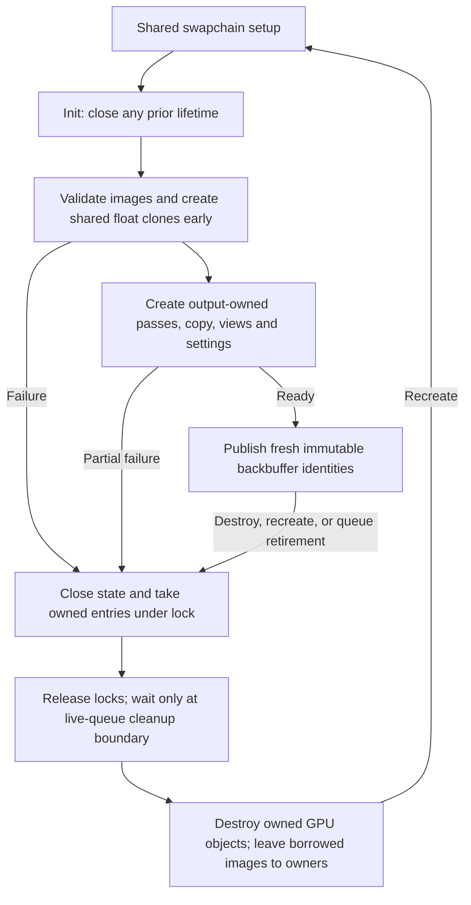

# RDR2 Vulkan architecture

## Purpose and reading order

The addon keeps HDR scene detail through the game's effects, separates scene brightness from interface brightness, and converts the result to HDR10 for the display. The C++ code decides where to record the extra drawing work and how long its resources must live. It does not replace the shader algorithms merely by reorganizing their owners.

Start with the terms below, then follow the three diagrams. `addon.cpp` is the composition entry point. `output.hpp`, `scene_tracking.hpp`, and root `vulkan_hooks.hpp` replace the old mixed proxy; there is no compatibility facade. The [README](README.md) contains the quick start and separates completed local checks from pending game validation.

## Terms used here

| Term | Meaning and why it matters |
|---|---|
| CPU recording | The CPU writes instructions for the GPU to run later. Different CPU workers can record in a different order from the order those instructions are submitted. |
| Command list / command buffer | A recorded batch of GPU instructions. ReShade calls it a command list; Vulkan calls it a command buffer. A secondary list is a batch called from another list. |
| Draw / shader | A draw records an instruction to produce pixels. A shader is the small GPU program used by that instruction. A post-draw CPU callback means the instruction was recorded, not that pixels are finished. |
| Submit / queue | Submitting asks Vulkan to accept recorded batches onto a GPU work queue. `VK_SUCCESS` means accepted, **not GPU-completed**. Earlier GPU work may still be running. |
| Texture / buffer / view | A texture stores images; a buffer stores general data. A view describes how an operation accesses some of that storage. It is not another copy, and freeing a view need not free its underlying storage. |
| Render target / render pass | A render target receives pixels. A render pass groups draws using color and optional depth/stencil targets, and states whether to keep or clear their contents. `LOAD` keeps existing contents. |
| Depth / stencil / alpha | Depth stores distances used to decide which surfaces are visible. Stencil is a per-pixel mask controlling where draws are allowed. Alpha controls transparency; it is separate from depth and stencil. |
| Pipeline / pipeline layout | A pipeline is the drawing configuration: shaders, blending, tests, and related state. A layout describes the resource and settings slots those shaders may use. |
| Descriptor / binding | A descriptor identifies a view or data range; a binding puts it in a shader's slot. Push descriptors supply bindings directly instead of allocating a descriptor set from a shared pool. |
| Graphics snapshot | A saved drawing configuration, not a screenshot or saved pixels. Restoring it does not release cached driver objects. |
| Backbuffer / swapchain / acquire | A backbuffer is an output image; a swapchain rotates through a group of them. Acquisition grants use of one image subject to its synchronization. Returning from acquire does not mean its GPU wait has finished. |
| Clone / direct upgrade | The float backbuffer clone replaces the game's low-range drawing destination until HDR encoding. A direct format upgrade instead changes eligible scene texture storage; it does not clone every scene texture. |
| Semaphore / fence / barrier | A semaphore orders GPU work. A fence lets the CPU observe completion. A barrier establishes GPU access and ordering requirements; recording one is not a CPU wait. |
| Ownership / borrowed handle | An owner must arrange cleanup. A borrower may use an object only while its lifetime and identity are valid. A handle is a reusable identifier, not proof of ownership or a permanent object identity. |
| Mutex / shared owner | A mutex protects CPU data from other CPU threads, not from unfinished GPU work. A copied `shared_ptr` keeps CPU storage alive; it does not keep retired GPU objects usable. |

## 1. Components and owners

The solid dependency chain is `addon -> vulkan_hooks -> scene_tracking -> output -> shared RenoDX`. Output does not include scene tracking or native hooks back. Native hooks own original function pointers and installation state, **not GPU resources**. Diagnostics are a separate optional observer, not a rendering dependency. The policy headers keep their narrow jobs rather than becoming another renderer or resource framework.

### Public boundaries

All local names below are under `rdr2vk`. Internal lifecycle callbacks remain implementation details, not an API for `addon.cpp` to reach through.

| Entry point | Concrete responsibility |
|---|---|
| `output::Use(reason)` | Register/remove output lifecycle and presentation callbacks. Keep shared swapchain setup; replace only this addon's stock final-present callback. |
| `output::RenderSceneBrightness(...)` | Record the reused scene-copy and brightness operation beside the GPU objects it uses. The caller holds the output-state lock and supplies known image usage. |
| `output::OnAcquireBackBuffer(...)` | Start a new acquired-image use after successful acquisition; clear accepted drawing/source facts, not command-list uploads. |
| `output::GetDeviceSwapchains(...)` | Copy CPU owners while registry access is valid. Callers then lock and check each owner before borrowing mutable data. |
| `scene_tracking::Use(reason)` | Register/remove command recording, classification, submission-selection callbacks, and required descriptor binding history. |
| `scene_tracking::OnBeforeUIDraw(...)` | Check a genuine backbuffer UI boundary and, when safe, record a candidate brightness operation before it. |
| `scene_tracking::OnSceneDrawRecorded(...)` | Observe recorded scene writes; never report GPU completion. |
| `scene_tracking::RecordingScope` | Keep native begin flags available during the original begin call and restore an enclosing scope on return. |
| `scene_tracking::SubmissionScope` | Collect tentative decisions during one original submit call; preserve enclosing thread-local context for nested calls. |
| `scene_tracking::PublishSubmission(...)` | Publish tentative facts only when the native submit result is `VK_SUCCESS`; rejection cannot undo earlier accepted work. |
| `vulkan_hooks::Use(reason)` | Required root hook lifecycle: Acquire1/2, Begin, Submit1/2, including the existing KHR fallback. Forward arguments and results unchanged. |
| `diagnostics::Use(reason)` | Optional recorder, callback, file, and exception-observer lifecycle. |
| `diagnostics::vulkan_hooks::Use(reason)` | Optional native view/descriptor/fence hook group, independent of the required rendering group. |

`vulkan_types.hpp` provides minimal x64 native declarations and ABI size/offset checks without requiring a Vulkan SDK for production. Opaque submit arrays are forwarded, not interpreted. These declarations do not authorize reading private driver object layouts.

## 2. CPU recording through accepted submission and output

This is a CPU decision path, not a GPU-completion timeline. Acquire1/2 call `output::OnAcquireBackBuffer` only for `VK_SUCCESS` or `VK_SUBOPTIMAL_KHR`. Begin uses `RecordingScope`; Submit1/2 keep `SubmissionScope` around the original native call and then call `PublishSubmission`. ReShade's list-execution callbacks run before that result is known, so their decisions remain tentative. The output callback records final work on the immediate command list; shared presentation synchronization still controls its later submission and execution.

### Keep scene brightness separate from UI brightness

Let `G` mean Game Brightness and `U` mean UI Brightness. After all scene composition, multiply decoded scene RGB by `G / U` **before the first genuine UI draw onto the backbuffer**. The game then blends UI in its existing encoded color space. Final output multiplies the combined image by `U` and encodes BT.2020/PQ for HDR10. Thus the scene receives `G` and the UI receives `U`. The brightness pass leaves alpha unchanged; the existing UI shader RGB/alpha rules remain intact.

The intermediate is encoded BT.709 in an RGBA16F backbuffer clone. Its float storage retains negative and above-one values until output. Decoding uses gamma 2.2 with SDR EOTF Emulation enabled and sRGB otherwise; PsychoV forces that emulation off. This is not final-frame inverse tonemapping or a change to scRGB output.

| Classification rule | Why it exists |
|---|---|
| `0xFCD82342` remains UI. | Its role must not change merely because it samples or targets another image. Only a genuine backbuffer draw can form the brightness boundary. |
| `0x2C748C70` remains scene composition. | Its nonlinear pause blending must finish before `G / U`; scaling its inputs would change the blend. |
| Offscreen `0x071AB204` pause-background copies are not UI boundaries. | Pause processing, the background copy, and final composition are still part of the scene chain. |
| FXAA `0x599298B6` is known scene output. | It may follow a tone mapper recorded in another list. Its original shader math stays unchanged. |
| Copy `0x1FC46AC9`, MSAA copy `0xF60E4A26`, and TAA sharpening `0xEF9E7CFC` need a known scene source. | They can also serve menus. Copy inputs use set 1/binding 186; TAA sharpening uses binding 156. Earlier accepted source writes can establish the link. |
| Alpha-only or stencil-only work does not establish backbuffer UI. | The RGB write mask matters, including dynamic masks. Unknown RGB-write state remains unknown; it is not treated as proof of no UI. |

Scene source resolution reads saved **live** view/resource metadata. It does not ask the driver to inspect an old cached view that may have been freed. Destroyed source resources are removed from accepted source history so handle reuse cannot establish scene ancestry by itself.

Resource destruction also advances a counter owned by the game addon. If that counter changes before a native submission returns, the addon keeps the source history that destruction has already cleaned instead of restoring potentially freed handles from the pending submission. This may discard new source links from that interval, but it does not undo accepted draws or add a GPU wait.

### Why record a disabled candidate?

A worker can record UI before another worker records the scene. `OnBeforeUIDraw` therefore cannot choose the winning pass by CPU time. Each suitable list records its candidate with a private settings upload and `scene_brightness_enabled = 0`. During submission callbacks, the selector enables only the first suitable candidate following scene work in submission order. Other candidates remain disabled; with unequal brightness they can still contain a full-resolution copy and draw. This is not a claim of one recorded operation per frame.

Secondary-list facts are merged into their parent before selection. UI facts can be merged without borrowing the child's brightness upload; inherited render passes are not safe interruption points. Scene, UI, brightness, and failure are overlapping facts, not a single linear state. Named `RecordedDrawSummary` fields keep the selection inputs explicit.

Equal valid Game/UI Brightness still records the ordering facts but skips the extra copy, draw, and upload. Menu-only work needs no scene correction. If accepted work contains a scene but no genuine backbuffer UI, presentation uses `output::RenderSceneBrightness` before final output instead. That no-UI path requires known image usage and records settings into its GPU buffer with update/barrier commands; acquisition never overwrites mapped data that an earlier GPU use may still read.

Old acquisition IDs, scene after UI, repeated selected recordings, queue changes, or a required brightness pass that could not be recorded reject separation for that image use and report at the existing bounded scope. A later failure can disable a candidate selected earlier **inside the same pending submit**. It cannot safely rewrite or undo work already accepted in an earlier submit. Failed native submission does not publish its tentative scene/source facts or establish completion.

### One pre-UI interruption, in order

`scene_tracking::OnBeforeUIDraw` keeps the control flow together; `output::RenderSceneBrightness` performs the reused GPU operation.

1. Identify the actual original/clone target and check RGB writes, acquired-image identity, recording flags, and whether interruption is safe.
2. Require a single color target, preserved color/depth/stencil contents, no active queries, and push-descriptor support. Do not interrupt inherited or simultaneous-use recordings, or assume missing begin flags are safe.
3. Capture the complete Vulkan graphics configuration, including pipeline bindings stored separately from the snapshot's other fields, and save attachment descriptions. Resolve the expected clone and prepare this recording's settings upload using `shared.h`.
4. Materialize pending clears, then end the game pass. Record required depth/stencil ordering and the scene-copy/brightness commands.
5. Resume the original attachments with `LOAD`, using fixed zero values for unused color/depth/stencil clears. Restore graphics configuration, then let the original UI draw continue.

The fixed unused clear values avoid changing legacy render-pass cache keys for data `LOAD` does not use. Graphics restoration is explicit; a generic target rebind is not a substitute for correctly resuming a Vulkan pass. Barriers order GPU accesses but do not wait for the GPU on the CPU.

## 3. Create, recreate, and destroy

Output setup creates clones before workers need them, but the shared resource code owns those clones. Each initialized output entry is tied to one original/clone identity pair; its renderer bindings are never retargeted. Every destroy/init is a new lifetime, even if the swapchain pointer is reused and `resize == false`. Retirement closes the state and takes its owned entries under protection, releases locks, then performs queue-safe cleanup while the queue/device still exist. Device destruction is too late for cached queue access or new GPU cleanup work.

### Ownership and borrowing

| Object or facts | Owner | End or reuse boundary |
|---|---|---|
| Original backbuffer | Game/ReShade; output borrows | Swapchain lifetime. |
| RGBA16F backbuffer clone | Shared RenoDX resource code; output borrows | Shared clone cleanup. Output never destroys it as an owned scene copy. |
| Output/brightness renderers, temporary scene copy, generated views/layout/pipeline/sampler, no-UI settings buffer | `output::BackBufferState` in a fixed-size per-swapchain vector | Retire the immutable entry at a valid swapchain/queue lifecycle boundary. Generated objects belong to their render pass even after partial setup. |
| Mapped per-recording settings uploads | Command-list private `CommandListData`, attached with core `data::Create/Get/Delete` | Reuse only at a legal command-list reset; unmap/free when that list is destroyed. |
| Recorded targets, sources, and candidate selection | Command-list recording | Recording reset/begin. Preserve the existing private-data identity and compatible layout. |
| Accepted scene/UI/usage/source facts | Current acquired backbuffer use | Publish after accepted submit; clear only on successful acquisition, not on present. |
| Pending decisions and borrowed selected upload | One `SubmissionScope` | Publish or reject when the original native call returns. Restore an outer scope if nested. |
| Diagnostic history, reports, file, observer | Optional recorder | Bounded session/device cleanup; entirely absent from normal builds. No GPU ownership. |

The upload container is a **deque** so appending uploads does not invalidate the pointers borrowed by recorded/pending entries. Acquisition resets image-use facts, not upload storage. A command-list reset relies on the game's legal reset timing; neither a CPU frame number nor a successful submit grants permission to reuse GPU-visible data.

### Locks and lifetime checks

- The registry is private to output. Copy an owner with `GetDeviceSwapchains` or a narrow lookup while registry access is valid, then release registry protection before taking a state lock. No raw map-entry pointer escapes.
- Backbuffer lookup, scene-source publication, and resource cleanup provide stack storage for four copied owners through the standard polymorphic allocator. Larger snapshots can allocate rather than lose owners. Each call refreshes the snapshot; there is no persistent owner cache or new registry. Repeated offscreen lookups therefore avoid temporary heap storage in the usual one-swapchain case while keeping registry and state locks separate.
- The state mutex protects closing, backbuffer entries, accepted facts, and use of output-owned GPU objects. Recheck closing, index, acquisition, and original/clone identity as applicable after obtaining the owner. Keeping its `shared_ptr` is only CPU lifetime protection.
- Descriptor/pipeline records have their own short access scopes. Source resolution copies binding information, releases that lock, and then checks live resource metadata. Do not hold an unrelated map lock across another lookup merely because both are reads.
- Recording/rendering under the state lock can enter shared resource/render operations. Diagnostic callbacks may then take the recorder lock. The recorder must not scan resource registries while holding its lock; the first-failure resource scan runs outside it. This is a real dependency, not a universal promise that every subsystem follows one invented lock order.
- No registry/state lock surrounds queue waits or fullscreen/window operations. A window change can recreate output; presentation reacquires shared device/output data afterward instead of trusting a pointer from before that change.

### Why these containers fit

- The output vector is sized once to the actual backbuffer count. Indexed access is constant-time; entries are never individually moved after GPU setup. Retirement swaps the whole vector. Adding a hash map here would add work without helping indexed image access.
- Recording and pending-image vectors use linear scans over encountered backbuffers. Source vectors also use linear membership checks and retain capacity across legal resets. Large or duplicate-heavy source lists could make this costly, but no measured workload currently justifies another cache or hash set. Source publication must remain after consumer checks; collecting all sources earlier would change the algorithm.
- Settings uploads stay in a deque because recorded instructions borrow their addresses. Replacing it with a growing vector would invalidate those addresses. Pipeline records use a concurrent flat map because keyed lookup matters and stable map-entry addresses do not.
- A successful native submission consumes its pending source list by swapping storage into the output record. This removes the final element copy while preserving the earlier copy that isolates tentative work. The displaced storage is destroyed after releasing the state lock. Pending data is consumed, not reusable for a second publication.
- Diagnostic history uses fixed-capacity slots and rings, not an allocating event queue. The 16-probe window bounds normal lookup work; eviction and unknown history remain explicit. Packing the frame count next to the thread ID reduces each internal evidence record from 256 to 248 bytes on x64, saving 1,180,672 bytes across the table and recent-event ring without removing fields. This storage is absent when diagnostics are off.

These are bounded storage and copying improvements, not a measured frame-time gain. The full graphics snapshot, output-state locks, submission order, GPU barriers, and upload reuse boundaries remain necessary.

### Setup failures and capability limits

Setup validates resource ownership, dimensions, format, sample count, and required push-descriptor support. Partial create/view/map/layout/pipeline/sampler failure cleans up what this addon actually owns; it does not free borrowed originals or shared clones. Unpublished resources that were never queued do not require an invented per-frame wait.

Each final-output pass gets one checked default sampler during local setup, before output publication. Its existing `generated_samplers` list owns destruction through `proxy.Destroy`; no extra owner or cleanup path is added. This keeps presentation out of the shared renderer's unchecked automatic sampler-creation path without changing core code. A failed setup does not retry at acquisition or presentation; only an explicit output recreation starts a new setup attempt. Successful sampling is unchanged, but allocation moves from first presentation to setup.

Runtime identity, missing-clone, brightness-rendering, and final-output failures retain any potentially queued objects until safe retirement. Affected failures stay disabled at their existing image-use or backbuffer-lifetime scope; there is no expensive retry loop each present. Ordinary failure messages remain concise. A failed final HDR output is an error, **not a silent SDR fallback**. Missing optional diagnostics must not disable required output, and hook-removal failure must retain active original pointers/state instead of pretending removal succeeded.

## Composition in addon.cpp

These are registration phases, not a claim that device, command, or presentation events execute immediately in this order. `Use` receives the attach/detach reason. Keep each phase visible rather than hiding it in a generic loop.

| Attach order | Purpose |
|---|---|
| 1. Register addon; early `resource_fixes::Use` | Clear-only repair must run before shared end-of-pass handling drops pending clears. Copy conversion stays active. |
| 2. Configure policy; settings, random, shared swapchain, shared shader setup | Keep settings/shader descriptors inline, configure pipeline-layout eligibility and HDR10 policy, and establish shared dependencies. |
| 3. Gated `diagnostics::Use` | Prepare the optional observer before rendering/native producers can report. Failure remains local to diagnostics. |
| 4. `output::Use` | Install local output ownership and presentation callbacks after shared setup. |
| 5. `scene_tracking::Use` | Install recording/selection and functional descriptor history. |
| 6. Root `vulkan_hooks::Use` | Register required native boundary handling for device initialization. |
| 7. Gated `diagnostics::vulkan_hooks::Use` | Register a separate optional native hook group. |
| 8. Late `resource_fixes::UseDescriptorFilters` | Filter only after shared handler election; never replace another addon's callbacks. |
| 9. GPU-rule `init_device` callback | Apply the NVIDIA-specific upgrade rule after shared defaults. |

Detach order is explicit: **descriptor filters -> optional native hooks -> required native hooks -> scene tracking -> output -> gated recorder -> early repairs -> GPU-rule callback -> shared dependencies -> unregister addon**. Restore elected descriptor callbacks while shared state still exists; stop producers before their state and recorder disappear. GPU retirement belongs in live swapchain/queue callbacks, not late heavy cleanup in `DllMain`. A failed hook/observer removal must retain the state still needed by active callbacks. None of this establishes safe hot unloading while the game is running.

Required and optional hooks use independent core detour transaction groups. Required installation/removal state and original function pointers stay together. Optional installation failure cannot roll back required rendering hooks. Both groups forward original arrays, semaphores, fences, arguments, and results; neither adds waits or suppresses operations.

## Preserved shader and resource policy

- Shader files/registrations, settings keys/defaults/actions, and presets remain unchanged. `shared.h` remains the common 21-float, 84-byte `ShaderInjectData` contract, with `scene_brightness_enabled` at byte 80. Recording-local uploads and the no-UI buffer use that same layout, not a second brightness-control layout.
- NVIDIA-only direct R11G11B10-to-RGBA16F upgrades retain exact backbuffer-size matching and capability checks. Do not widen them to aspect-ratio matching or every scene texture. The backbuffer clone is a separate requirement for float composition before HDR10 output.
- Early clear-only repair remains for build-header API versions below 20. Existing supported copy conversion handles incompatible formats after a direct upgrade when neither endpoint uses a clone; it neither broadens upgrades nor recovers detail already lost in low-range storage.
- Pipeline layout eligibility is checked at creation and initialization. A nonempty pixel-visible range is required; layouts shared with compute still qualify. Added settings remain pixel-only; compute work using cloned textures still needs correct clone bindings.
- Elected descriptor filters inspect only live texture-clone candidates. Buffer-only/unrelated updates continue unchanged; an update that needs a clone still passes as a whole through shared handling. Functional descriptor binding history is required for scene-source decisions even with diagnostics disabled.
- No new per-frame waits, flushes, retries, background threads, renderer instances per recording, resource-routing framework, or frame-generation integration are implied.

## Diagnostics: observe without repairing

`diagnostics_config.hpp` owns the single `RDR2VK_ENABLE_LIFETIME_DIAGNOSTICS` define, default `0`, accepting only `0` or `1`. Its compile-time gate covers includes, types, histories, locks, timestamps, stack capture, file output, optional hooks, calls, and diagnostic argument preparation. It is not a runtime-muted logger. Required native rendering hooks, source-binding history, and ordinary failure messages remain independent.

The three responsibilities are `diagnostics/lifetime.hpp` for pure lifetime rules, `diagnostics/recorder.hpp` for typed observations/bounded reports/session lifecycle, and `diagnostics/vulkan_hooks.hpp` for optional original functions and native wrappers. Normal events update memory rather than continuously writing a file. Creation/destruction and selected reports can capture stacks outside the exception observer; enabled diagnostics can change CPU timing.

### Version 5 and bounded evidence

Trace files are `rdr2vk-view-lifetime-v5-<PID>-<QPC>.trace` beside the executable, with a per-run high-resolution counter in the name. New-file creation preserves earlier traces. Keep a crash trace with `ReShade.log`, the exact addon, matching symbols, module versions, and the crash dump.

Version 5 removes the version-4 `blocked_duplicates` field and `buffer_destroy_blocked` event. **There is no destroy mitigation in either build.** Repeated native destruction is observed and forwarded, not skipped; descriptor writes and failed creation outputs are not repaired. Do not run an old deliberate duplicate-native-destroy test expecting protection: it makes invalid driver calls. A saved handle match is evidence about captured calls, not permission to alter them.

| Bound | What can be missing |
|---|---|
| 16,384 device/view slots, bounded 16-probe lookup | Slots may be evicted/replaced or calls left untracked. Active current-generation destruction entries are not eviction candidates. Missing history means unknown. |
| 128 recent view events; 256 synchronization events | Older events roll out. These are recent windows, not a complete lifetime log. |
| 128 texel-buffer references captured per descriptor update | All readable original references are checked; only the first 128 are saved for exception/return observation. Unreadable inputs leave gaps. Image/buffer payloads, descriptor copies/templates, push descriptors, and actual shader reads are not fully covered by this native trace. |
| Four synchronization handles; 31-byte names | Multi-fence details and longer labels are truncated. Calls bypassing hooks are absent. |
| Eight view-error, four access-violation, 16 failed-creation reports | Repeated reports are limited. Absence of a report does not prove absence of an error. |
| First-failure resource summary | Existing live-resource counts and texture-byte totals are incomplete, non-atomic estimates, not driver memory usage or a leak proof. Zero tracked uploads does not prove zero addon uploads. |

Requests connect native entry/return and related callbacks, including nested calls; generations describe captured device/handle history. Reused or aliased handles can remain ambiguous. Descriptor capture preserves valid CPU input values before the original call returns and associates return observations with that batch. A native return or fence-history entry does not prove that every recorded view use finished on the GPU.

The first allocation-failure summary scans existing resource records **outside the recorder lock** to avoid reversing resource-to-recorder lock ordering. It does not add continuous allocation accounting. Eviction, untracked/skipped entries, truncation, and report caps must remain visible when interpreting a trace.

### Narrow exception observation

The exception observer records an access violation when a descriptor update is active, a hooked native call is creating a buffer view or destroying an image/buffer view, or the failing instruction is inside the known NVIDIA Vulkan driver range. An active native call lets it record an invalid jump outside the driver module too. That context does not prove what caused the fault. Each report names the active request, device, view, and operation; the same call is not reported twice. The observer skips reporting if its lock is busy or it is already running. It records CPU register values and any saved descriptor batch, then compares those register values with saved handles. It prints at most 16 possible matches.

It performs **no freed-memory reads, native-object queries, nearby-memory search, observer stack walking, symbol lookup, or allocation**. It can print evidence already captured before the exception. Register matches are candidates, not proof of the faulting object's identity. Busy locks, missing history, or caps can leave no report. The observer always returns `EXCEPTION_CONTINUE_SEARCH`; another handler may recover, so first-chance observation is not automatically a fatal crash.

File/history/observer initialization failure cleans up partial diagnostic state without changing rendering. Optional hook teardown stops future producers and retains originals/recorder state if removal fails. Required rendering producers also stop before recorder teardown. These lifecycle precautions do not make hot unload supported.

## Known limits, not fixes promised by the rewrite

| Limit | Consequence |
|---|---|
| ReShade API-18 graphics dynamic-offset replay | The existing graphics snapshot restoration does not establish complete replay of those offsets. Renaming or moving it does not fix that gap. |
| Descriptor-pool history reuse | Required source-binding history retains its existing reuse/coverage limits; it is not a perfect resource-lifetime oracle. |
| Private backend cache retention | Releasing addon-owned views or restoring graphics state does not prove cached backend render passes/framebuffers/descriptors were released. Fixed unused LOAD clears address one cache-key source, not every cache lifetime. |
| Single-device native function-pointer assumptions | Required and optional groups retain the existing assumption about native addresses. The rewrite does not certify arbitrary multi-device operation. |
| Shared descriptor-handler handoff | Filtering depends on election and callback replacement/restoration. Another owner's callbacks are left alone; later handoff does not promise every future owner retains this addon's filters. |
| Unsupported scene/UI order or unknown state | Existing rejection and failure checks remain; there is no fabricated successful separation or silent output-mode fallback. |
| Prolonged-play allocation crash | Still unresolved. Cleaner ownership and observation-only diagnostics are not evidence that it is fixed. |

## Old-to-new reading map

This maps responsibilities out of the old proxy, not a compatibility layer to keep calling. Private callbacks may keep their familiar names under their new owner; addon integration uses the public boundaries above.

| Old location or symbol | New owner / entry point |
|---|---|
| `swapchain_proxy::Use` | Explicit addon composition of `output::Use`, `scene_tracking::Use`, root `vulkan_hooks::Use`, and separately gated diagnostics. No proxy facade. |
| Proxy `BackBufferState`, `SwapchainState`, registry, `GetDeviceSwapchains` | `output.hpp`; registry remains private, `output::GetDeviceSwapchains` copies owners. |
| `BackBufferSubmission::ApplyRecording(bool, bool, bool, bool)` | `output::AcceptedDraws::ApplyRecording` with named `RecordedDrawSummary` input. |
| `ShaderInjectionBuffer` / `DestroyShaderInjectionBuffer` | `output::SettingsUpload` / `output::DestroySettingsUpload`; command lists still own recording uploads. |
| Proxy `RenderSceneBrightness` | `output::RenderSceneBrightness`, reused for pre-UI and scene-only output. |
| Proxy init/present/retire/swapchain/queue/device callbacks | `output.hpp` lifecycle callbacks registered by `output::Use`. GPU cleanup stays before queue/device expiry. |
| Proxy `CommandListData`, recording/pass/query/pipeline/barrier/secondary callbacks | `scene_tracking.hpp`, retaining core private-data ownership and stable upload deque. |
| `swapchain_proxy::OnSceneDrawn` | `scene_tracking::OnSceneDrawRecorded`, explicitly naming CPU recording. |
| `swapchain_proxy::OnBeforeUIDraw`, `ON_SCENE_OUTPUT` | `scene_tracking::OnBeforeUIDraw` and internal command-action source classification. |
| Proxy submit TLS / `CommitBackBuffers` | `scene_tracking::SubmissionScope` / `scene_tracking::PublishSubmission`. |
| Proxy begin flags | `scene_tracking::RecordingScope`, entered by the root native Begin wrapper. |
| Proxy `OnAcquireBackBuffer` | `output::OnAcquireBackBuffer`, called after accepted Acquire1/2 results. |
| Proxy Acquire/Begin/Submit wrappers and required native pointers | Root `vulkan_hooks.hpp`, registered through `vulkan_hooks::Use`. |
| Proxy optional view/descriptor/fence wrappers | `diagnostics/vulkan_hooks.hpp`, a separate transaction group. |
| `view_lifetime_state.hpp` | `diagnostics/lifetime.hpp`: observation-only pure rules. |
| `view_lifetime_evidence.hpp` / `view_lifetime_trace.hpp` | `diagnostics/recorder.hpp`: typed observations, bounded history/reports, file/observer lifecycle; switch moves to `diagnostics_config.hpp`. |
| Inline proxy native declarations | `vulkan_types.hpp`: minimal checked x64 API boundary declarations. |
| `resource_fixes.hpp`, `pipeline_layouts.hpp`, `shared.h`, shader/settings definitions | Retain their focused responsibilities and behavior; not replaced by the split. |

## Validation and remaining game checks

Build target `rdr2vk` with the repository's existing build rules. No local test suite, extra CMake registration, or changes to shared RenoDX code are required. Both diagnostic configurations have been built using the selected MSVC Release toolchain. Local checks exercise production callbacks for drawing-state restoration, resource retirement, setup failures, and exception observation; they are development evidence, not a shipped dependency or proof of real scene/UI pixels.

Earlier resource-safety, LOAD-cache, and 100-legal-view smoke checks per addon mode are historical, not current full-runtime validation. Current binary checks confirm absence of optional report markers in the normal variant and their presence in the diagnostic variant; they are not a full preprocessed/symbol equivalence proof. Do not carry old blocker-dependent results forward or run the old deliberate duplicate-native-destroy test.

The pending game checklist and unresolved AMD/OptiScaler compatibility report are in the README. Accepted submission is never completion evidence; fresh-save/HUD transitions, pause composition, recreation, actual HDR range, and prolonged play still need real checks. Loading an installed build alone does not satisfy that checklist.