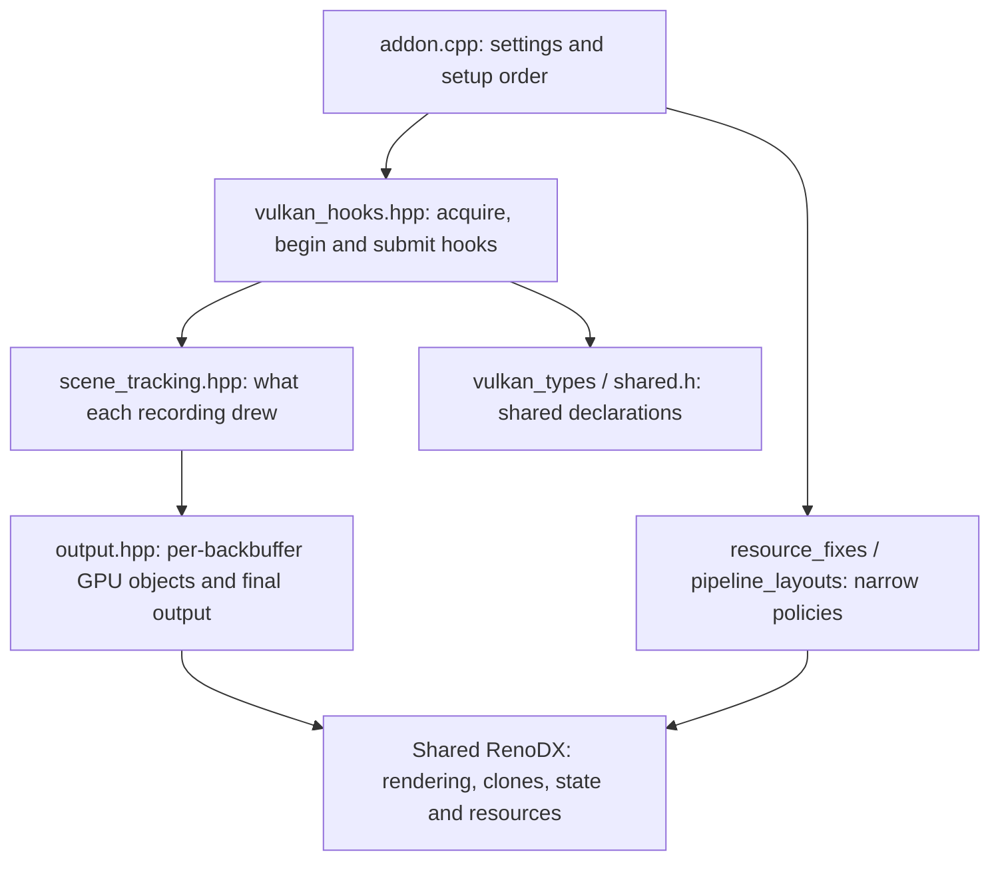
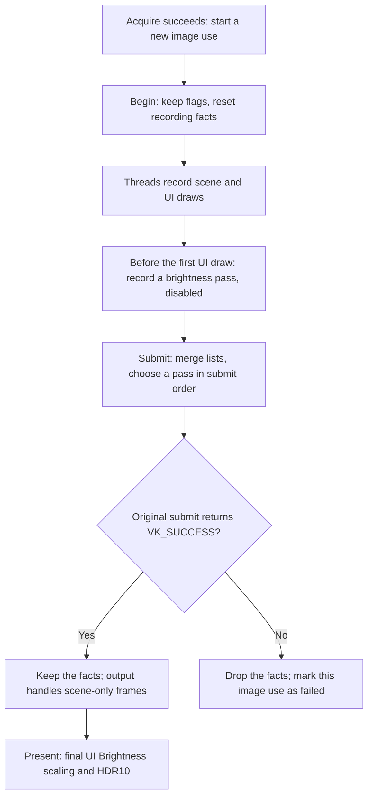
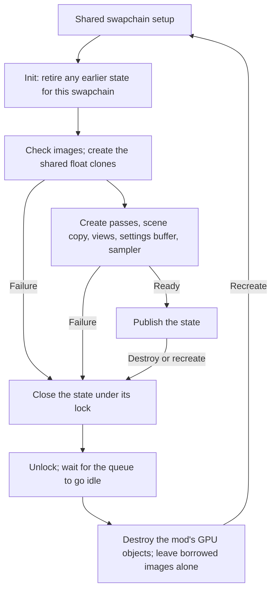

# RDR2 Vulkan architecture

The mod keeps HDR scene detail through the game's effects, gives the scene and the interface separate brightness, and converts the result to HDR10. The C++ code decides where to record the extra drawing work and how long its GPU objects live; the shaders do the color math.

The [README](README.md) covers setup, status, and the checks still owed in the game. This file covers how the code is organized and the rules it relies on.

## Terms

| Term | Meaning |
|---|---|
| Recording | The CPU writes instructions for the GPU to run later. Several CPU threads can record at once, in a different order from the one in which their work is submitted. |
| Command list | A recorded batch of GPU instructions; Vulkan calls it a command buffer. A secondary list is a batch run from inside another list. |
| Submit | Hands recorded lists to a GPU queue. `VK_SUCCESS` means Vulkan accepted them, not that the GPU has run them. |
| View | Describes how an operation reads or writes a texture or buffer. It is not a copy, and destroying it does not free the storage. |
| Render pass | A group of draws into the same targets, which says whether existing contents are kept (`LOAD`) or cleared. |
| Pipeline / layout | A pipeline is the drawing configuration (shaders, blending, tests). Its layout lists the resource and settings slots the shaders use. |
| Descriptor | Identifies a view or data range for a shader slot. Push descriptors are supplied directly instead of being allocated from a shared pool. |
| Graphics snapshot | The saved drawing configuration, not saved pixels. |
| Backbuffer / swapchain | A swapchain cycles through a few output images, the backbuffers. Acquiring one grants its use; the GPU may still be waiting on it. |
| Clone | The RGBA16F copy of a backbuffer that the game draws into instead, so values above SDR white survive until HDR10 encoding. |
| Barrier | Orders GPU accesses to a resource. Recording one does not make the CPU wait. |
| Owner / borrower | An owner must clean an object up. A borrower may use it only while it is alive. A handle value can be reused for a new object after the old one is destroyed. |

## Files

Dependencies run one way: `addon -> vulkan_hooks -> scene_tracking -> output -> shared RenoDX`. The hooks own their original function pointers, not GPU objects.

| Entry point (namespace `rdr2vk`) | What it does |
|---|---|
| `output::Use(reason)` | Registers the swapchain, presentation, and cleanup callbacks. Uses the shared swapchain setup but replaces its final present step. |
| `output::RenderSceneBrightness(...)` | Records the scene copy and the brightness draw. The caller holds the swapchain state lock and knows the image's current usage. |
| `output::OnAcquireBackBuffer(...)` | Starts a new use of an image after a successful acquire and clears what was known about its previous use. |
| `output::GetDeviceSwapchains(...)` | Copies the swapchain owners for a device. Callers lock and recheck each one before use. |
| `scene_tracking::Use(reason)` | Registers the recording, classification, and submission callbacks and turns on descriptor binding history. |
| `scene_tracking::OnBeforeUIDraw(...)` | At the first real UI draw onto a backbuffer, records a brightness pass in front of it when that is safe. |
| `scene_tracking::OnSceneDrawRecorded(...)` | Notes that a scene draw was recorded. |
| `scene_tracking::RecordingScope` | Keeps the command buffer's begin flags available during the original begin call. |
| `scene_tracking::SubmissionScope` / `PublishSubmission(...)` | Collect decisions made during one submit call and keep them only if the submit returns `VK_SUCCESS`. |
| `vulkan_hooks::Use(reason)` | Installs and removes the native acquire, begin, and submit hooks. They forward every argument and result unchanged. |

`vulkan_types.hpp` declares the few Vulkan types the hooks need, with size and offset checks, so the mod does not need the Vulkan SDK.

## How the game builds a frame

Captured with the DevKit in November 2026, SDR path, DLSS unless noted. Every tone map writes the same full-size texture, which the game calls `Working LDR Texture`; it is R11G11B10, upgraded to RGBA16F on NVIDIA.

| State | Scene steps, in order | Then |
|---|---|---|
| Gameplay, HUD shown or hidden | tone map -> copy `0x1FC46AC9` to the backbuffer | UI on the backbuffer, if any |
| FXAA | tone map -> FXAA `0x599298B6` writes the backbuffer | UI |
| TAA with sharpening | tone map -> sharpening `0xEF9E7CFC` writes the backbuffer | UI |
| Weapon wheel | tone map -> blurs -> regrade `0x2B012EDD` writes the backbuffer | wheel UI |
| Map | pause tone map -> regrade `0x2B012EDD` writes the backbuffer | map UI |
| Dead Eye | Dead Eye tone map -> copy `0x1FC46AC9`, or regrade `0x2B012EDD` | UI |
| Pause | pause tone map -> blurs that use the backbuffer as scratch -> regrade `0x2B012EDD` reads the backbuffer -> copy -> paper overlay `0x2C748C70` -> copy `0x1FC46AC9` to the backbuffer | menu UI |

In every state, exactly one draw writes the finished scene to the backbuffer, and the UI follows it directly. Some HUD parts are first drawn into offscreen textures (the 512x512 minimap, a 4K RGBA8 layer) and then onto the backbuffer. UI that reaches the backbuffer blends alpha with `one` and `one - source alpha`; `0x7BE28339` writes stencil only.

The executable also has a post-HUD stage (`Working PostHud Backbuffer Pair`, `ColorLUT - POSTFX POSTHUD`). When a flag in the render state is set, the game copies the backbuffer into that buffer, draws the HUD there, and applies a LUT over scene and HUD together. Dead Eye, pause, the weapon wheel, and the map do not turn it on; what does is unknown.

## From recording to output

Acquire calls `output::OnAcquireBackBuffer` for `VK_SUCCESS` and `VK_SUBOPTIMAL_KHR`. ReShade runs its list callbacks inside the original submit, before its result is known, so decisions made there stay tentative until `PublishSubmission`. The present callback records the final output on ReShade's immediate command list.

### Scene brightness and UI brightness

Let `G` be Game Brightness and `U` UI Brightness. After the scene is complete and before the first real UI draw onto the backbuffer, the brightness pass multiplies the decoded scene by `G / U`. The game then draws its UI as usual. Final output multiplies everything by `U` and encodes BT.2020 PQ. The scene ends up at `G` and the UI at `U`. Alpha is left unchanged.

Until final output, the image is encoded BT.709 in the RGBA16F clone, which keeps negative and above-one values. Decoding uses gamma 2.2 when SDR EOTF Emulation is on and sRGB otherwise; PsychoV turns the emulation off.

| Shader rule | Reason |
|---|---|
| `0xFCD82342` is UI. | Only a real UI draw onto the backbuffer marks where scene brightness goes. |
| `0x2C748C70` is scene composition. | Its pause blending must finish before `G / U`; scaling its inputs would change the blend. |
| Offscreen `0x071AB204` pause-background copies are not the UI boundary. | Pause processing and the background copy are still part of the scene. |
| FXAA `0x599298B6` is scene output. | It can follow a tone mapper recorded in another list. |
| Copy `0x1FC46AC9`, MSAA copy `0xF60E4A26`, and TAA sharpening `0xEF9E7CFC` count as scene only with a known scene source. | They also serve menus. Copies read set 1 binding 186; sharpening reads binding 156. |
| Draws that write only alpha or stencil are not UI. | The RGB write mask decides, including dynamic masks. An unknown mask is treated as unknown. |

Scene sources are resolved from the shared resource records of live views, never by asking the driver about a view that may be gone. When a source resource is destroyed, it leaves the source history, so a reused handle cannot pass as a scene source. Destruction also advances a counter; if it moved while a submit was in flight, that submit does not restore its pending source list.

### Why the brightness pass is recorded disabled

A thread can record UI before another records the scene, so recording time cannot decide which pass runs. Each suitable list records its own pass with its own settings upload and `scene_brightness_enabled = 0`. During submission, the first pass that follows scene work in submit order is switched on. The others stay off, but with unequal brightness they still contain a full-screen copy and draw.

Facts from secondary lists are merged into their parent before that choice.

With equal brightness the pass is not recorded at all. If accepted work has a scene but no UI, presentation runs `output::RenderSceneBrightness` before the final output, writing its settings through an update command so that no buffer still in use on the GPU is overwritten.

A stale acquire, a scene drawn after the UI, a pass selected twice, a queue change, or a pass that could not be recorded turns separation off for that image use and logs the reason once per backbuffer. A later failure can still switch off a pass selected earlier in the same submit, but not work an earlier submit already handed over.

### Interrupting the game's pass before the UI

`scene_tracking::OnBeforeUIDraw` makes the decisions; `output::RenderSceneBrightness` records the GPU work.

1. Confirm the target is the backbuffer clone, the draw writes RGB, the image use is current, and the list can be interrupted.
2. Require one color target, stored color, depth and stencil, no active queries, and push descriptor support. Never interrupt a list that continues its parent's render pass, a list that may run more than once at the same time, or one whose begin flags are unknown.
3. Save the graphics snapshot, including pipeline bindings, and the attachment descriptions. Prepare this list's settings upload in the `shared.h` layout.
4. Apply pending clears, end the game's pass, and record the scene copy and brightness draw.
5. Resume the game's attachments with `LOAD` and zero clear values, restore the snapshot, and let the UI draw continue.

Where ReShade caches render passes, the clear values are part of the cache key; fixed zeros keep it from adding an entry each time the game's clear color changes.

## Swapchain lifetime

Every init is a new lifetime, even when Vulkan reuses the swapchain pointer and reports `resize == false`. Each backbuffer entry is bound to one backbuffer and one clone for its whole life. Retirement closes the state and takes its entries under the lock, then waits for the queue and destroys the GPU objects after unlocking, while the queue and device still exist.

### Final output

Each backbuffer has its own final output pass, bound once at setup to that backbuffer, its clone, the output shaders, and the settings. Presentation looks the entry up by the acquired image index and renders it. **Presentation never asks the swapchain for its images.** On Vulkan, ReShade answers `get_back_buffer`, `get_current_back_buffer`, and `get_back_buffer_count` with `vkGetSwapchainImagesKHR`, and the Steam overlay's layer leaks a semaphore on every such call. The images recorded at setup stay valid: Vulkan never changes a swapchain's images, and when the game recreates its swapchain, ReShade sends `destroy_swapchain` and then `init_swapchain`, which rebuilds the entries.

### Owners

| Object | Owner | Ends |
|---|---|---|
| Backbuffer | The game; output borrows it | With the swapchain. |
| RGBA16F clone | Shared RenoDX resource code; output borrows it | At shared clone cleanup. |
| Output and brightness passes, scene copy, views, layout, pipeline, sampler, no-UI settings buffer | `output::BackBufferState`, one per backbuffer | At swapchain retirement. A pass owns what it generated even after a partial setup. |
| Mapped settings uploads | The command list's `CommandListData` | Reused at a legal list reset; freed when the list is destroyed. |
| Recorded targets, sources, and candidates | The recording | At list reset or begin. |
| Accepted scene, UI, usage, and source facts | The current image use | Set after an accepted submit; cleared at the next successful acquire. |
| Pending decisions | One `SubmissionScope` | When the original submit returns. |

Settings uploads live in a deque, because recorded commands hold their addresses and a growing vector would move them.

### Locks

- The swapchain registry is private to output. Code copies an owner out of it, releases it, and only then takes that owner's state lock.
- The state lock guards closing, the backbuffer entries, accepted facts, and use of the output's GPU objects. After taking it, code rechecks closing, index, acquisition, and backbuffer/clone identity as needed.
- Descriptor and pipeline records have their own short locks. Source resolution copies binding information, releases that lock, then checks live resources.
- No lock is held across queue waits or window changes. After a window change, presentation looks up the shared data again.

### Failures

Setup checks ownership, size, format, sample count, and push descriptor support, and creates the output sampler itself so that a failure is caught before the state is published. A failed setup is not retried until the swapchain is recreated. A failure at presentation disables that backbuffer until recreation and keeps its GPU objects until the queue is idle. A failed HDR output is logged as an error; there is no silent SDR fallback.

## Setup order in addon.cpp

| Attach step | Why |
|---|---|
| 1. Register the add-on; early `resource_fixes::Use` | Clear-only repairs must run before the shared end-of-pass code drops pending clears. |
| 2. Settings, random, shared swapchain, shared shader setup | Configures pipeline layout eligibility and HDR10 output. |
| 3. `output::Use` | After the shared swapchain setup. |
| 4. `scene_tracking::Use` | |
| 5. `vulkan_hooks::Use` | Installs the hooks when the device is created. |
| 6. `resource_fixes::UseDescriptorFilters` | After the shared descriptor handler is elected, so another add-on's callbacks are never replaced. |
| 7. GPU-specific `init_device` callback | Applies the NVIDIA-only upgrade after the shared defaults. |

Detach runs: descriptor filters, hooks, scene tracking, output, early repairs, GPU callback, shared code, unregister. If removing the hooks fails, the original pointers stay in place. Unloading the add-on while the game runs is not supported.

## Shader and resource rules

- `shared.h` defines `ShaderInjectData`: 21 floats, 84 bytes, with `scene_brightness_enabled` at byte 80. Per-list uploads and the no-UI buffer use the same layout.
- The R11G11B10 to RGBA16F upgrade is NVIDIA-only and limited to textures exactly the size of the backbuffer. The backbuffer clone is a separate mechanism.
- Clear-only repairs apply when the build's ReShade headers are older than API 20. Copies between formats that no longer match after an upgrade are converted when neither side is a clone.
- Settings are added only to pipeline layouts with a pixel-visible range; layouts shared with compute still qualify.
- Descriptor filters look only at live texture clones. Other updates pass through unchanged.

## Known limits

| Limit | Effect |
|---|---|
| Dynamic offsets after the pre-UI pass | With ReShade API 18 headers, restoring the graphics snapshot does not replay descriptor dynamic offsets. |
| Descriptor pool reuse | Source binding history inherits the shared tracker's limits when pools are reset and reused. |
| ReShade's cached render passes and framebuffers | Destroying the mod's views does not free them. |
| One device | The hooks assume every device shares the same native function addresses. |
| Descriptor handler election | If another add-on takes over the shared descriptor handler later, it may not keep this mod's filters. |
| Crash investigation | The `rdr2vkprobe` add-on records object lifetimes, creation failures, and memory trends without changing the mod. |
| Post-HUD stage | When the game draws the HUD into its post-HUD buffer instead of the backbuffer, the first UI draw on the backbuffer is not the scene/UI boundary. Never seen in play so far. |
| Map transition | Before the tone map, `0x1994C234` composites the scene into an 8-bit 4K texture that the gameplay tone map blends in, probably while the map opens or closes. Highlights may clip there; not checked by eye. |

## Planned: frame generation

DLSS Frame Generation through Streamline needs, for every frame: the final image, the same image without UI (HUD-less), UI alpha, depth, motion vectors, camera data, and Reflex markers. It also has to own presentation. The mod only outputs HDR10 (PQ, BT.2020), so only that swapchain has to work. Nothing below is implemented yet. The order puts the riskiest question first. Points marked *(unverified)* have not been checked on this game yet.

### 1. Prove Streamline can run inside the add-on

Everything else depends on this, so it comes first, as a throwaway test outside the mod.

- **Below ReShade.** Streamline takes over swapchain creation, image queries, acquire, and present. The mod writes the swapchain image during ReShade's present handling, so Streamline must sit below ReShade: it sees each frame after the final output, and the frames it generates go to the driver without passing through ReShade and the mod again. The mod already detours native Vulkan functions, so the driver-side swapchain functions can be routed through Streamline's. Putting Streamline's interposer in front of the game's Vulkan loader would do the opposite: Streamline would get the swapchain image before the mod writes it, and every generated frame would go through ReShade.
- **Device creation.** On Vulkan, Streamline must be initialized before the device exists, and it may need extra device extensions, features, and queues (graphics, compute, optical flow). ReShade loads add-ons inside the game's `vkCreateInstance`, and the game creates its device later on another thread, so an add-on can call `slInit` (manual hooking), hook device creation to add what `slGetFeatureRequirements` asks for, and then call `slSetVulkanInfo` with the added queues. The game's device already has `VK_KHR_timeline_semaphore` and `VK_KHR_push_descriptor`.
- **Queues.** Add Streamline's queues ourselves instead of letting its interposer plan them. The game asks for one graphics queue, every queue in the compute family, and two transfer queues *(unverified)*. For that request, the Streamline 2.14.1 interposer adds a duplicate compute-family entry and device creation fails. The extra compute queues have to go to a family with spare capacity, such as the graphics family. Log the game's request with the probe first.
- **Instance.** The game asks for Vulkan 1.1 with `VK_KHR_get_physical_device_properties2`, `VK_KHR_get_surface_capabilities2`, `VK_KHR_surface`, `VK_KHR_win32_surface`, and `VK_EXT_swapchain_colorspace`. The instance already exists when an add-on can act, so whatever Streamline needs at instance level must already be in that list.
- **Calls to adapt.** The exe references `vkAcquireNextImage2KHR`, device-group present, and `VK_EXT_buffer_device_address`, which Streamline does not take as they come *(unverified)*. Pass acquire 2 to Streamline as `vkAcquireNextImageKHR` when the device mask is 1, drop a device-group present mask of 1, and hide the EXT buffer device address extension from the game so Streamline uses the core version.
- **Reflex.** The game calls `NvLL_VK_SetSleepMode` and `NvLL_VK_SetLatencyMarker` itself through `NvLowLatencyVk.dll`. Start by leaving those calls alone, sending Streamline's PCL markers from the mod, and not calling Streamline's Reflex sleep. Whether the driver handles both sets of markers cleanly is unknown.
- **HDR.** DLSS-G has a status bit for an unsupported HDR setup, and an HDR10 backbuffer with DLSS-G on Vulkan is unproven, so the test uses the mod's real swapchain.

Done when Streamline generates frames from placeholder inputs while ReShade and the mod still present correctly. Known Vulkan limits: no VSync with frame generation and no dynamic multi-frame generation.

### 2. HUD-less image and UI alpha from the mod

These can be built and checked with the DevKit before Streamline is in.

- **Run the brightness pass every frame** while frame generation is on, including when Game and UI Brightness are equal (scale 1). Today it is skipped then.
- **Second output: the HUD-less image.** The brightness shader writes the scaled scene to the clone as now, in gamma-encoded BT.709 so the UI keeps blending in gamma, and also writes the same color through `renodx::draw::SwapChainPass` into a backbuffer-sized HDR10 texture. The final output calls the same function on the same values, so the two match exactly wherever there is no UI, which frame generation relies on. DLSS's own output cannot stand in for it: it comes before the tone map, so it is not in the backbuffer's color space.
- **Alpha 0 for the clone.** The tone map stores luma in alpha for FXAA, and the copy carries it to the backbuffer. Nothing after the UI starts reads it, so the brightness pass writes alpha 0. The UI's alpha blend then leaves the clone's alpha equal to UI coverage.
- **Second output of the final pass: UI alpha.** The final pass copies the clone's alpha into its own texture. The swapchain's 2-bit alpha is too coarse to tag. Tag UI alpha only, without UI color. Streamline expects `final = UI color + (1 - UI alpha) x HUD-less`, which a UI color of ours would not satisfy after a gamma-space blend and a PQ encode; with alpha only, it has no UI color to compare.
- **Frames without UI.** The scene-only path at present writes the HUD-less image the same way, and UI alpha is 0.
- **Still to check:** the draws that composite the offscreen HUD layers onto the backbuffer, and the menu UI, must write alpha with the same blend. Any that do not would need a pipeline variant that writes alpha, or a UAV write in that shader only.

### 3. Depth, motion vectors, and camera data

- **Depth and motion vectors** come from the game's DLSS call. `src/utils/dlss/nvngx.hpp` only handles D3D12 today. With FXAA or TAA there is no DLSS call, so frame generation would first require DLSS or DLAA.
  - Hook `GetProcAddress`, which the game uses to find NGX *(unverified)*, to wrap `NVSDK_NGX_VULKAN_CreateFeature` for the DLSS flags (`DLSS.Feature.Create.Flags`: inverted depth, low-resolution motion vectors, jittered motion vectors) and `NVSDK_NGX_VULKAN_EvaluateFeature` for the inputs. The exe references both names.
  - The driver exports no C functions for reading NGX parameters, so read them through the parameter object's virtual table.
  - Read `Depth`, `MotionVectors`, `Jitter.Offset.X`/`Y`, `MV.Scale.X`/`Y`, `Reset`, and the subrect sizes and origins (`DLSS.Render.Subrect.Dimensions.*`, `DLSS.Input.Depth.Subrect.Base.*`, `DLSS.Input.MV.Subrect.Base.*`). Skip evaluations that carry `DLSSG.Backbuffer`; they belong to DLSS-G.
  - Tag depth (`D32_SFLOAT_S8_UINT`) and motion vectors (`R16G16_SFLOAT`) on the evaluate's command buffer as valid only now, so Streamline copies them there and the mod keeps no copies. The tag needs each image's current layout, tracked from the command buffer's barriers.
  - Divide the motion vector scale by the motion vector size, because Streamline multiplies it back, and set reset when the DLSS quality mode changes.
- **Camera data.** Start with a neutral camera: a fixed projection (60-degree vertical field of view, near 0.05, far 10000), identity clip-to-previous-clip, and camera motion marked as included in the motion vectors. DLSS-G accepts that and generates frames *(unverified)*, so the game's matrices do not block a first version. Then read the real view-to-clip and clip-to-previous-clip matrices from the game's per-frame constant buffers once their location is known, and check whether they improve the result.

### 4. Per-frame tagging and pacing

- **One frame token per frame**, shared by the markers, the tags, and the constants. Evaluate and present can run on different threads, so match inputs to a present through the submitted command buffers, not the order calls arrive in. When the match fails, skip the frame instead of using the newest inputs.
- **When frame generation runs.** Turn it on only after DLSS has evaluated for a while, and off when it stops (title video, loading screens), keeping its resources while off so turning it back on does not stall. Turn it off before the swapchain is recreated. Set reset on camera cuts.
- **Lifetimes.** Vulkan resources stay alive on the mod's side, because Streamline does not hold references to them on Vulkan.
