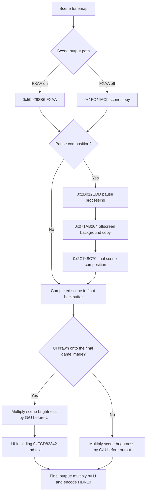

# Red Dead Redemption 2

Use Vulkan with **Windows HDR on** and **HDR off in the game's settings**. If you are upgrading from the older `rdr2vk` version with different tone mapper numbers, **reset your saved RenoDX presets**. This avoids applying old settings to the wrong tone mapper.

## Tonemapping

The mod changes how the game maps scene brightness to the display while the image still contains HDR detail. It uses higher-precision textures to keep that detail until the final HDR10 output. It does not try to create HDR by stretching an already-finished SDR image. The game's exposure, bloom, vignette, color grading masks, and color lookup tables (LUTs) remain in use.

The main scene shaders use two functions in `tonemap/tonemap.glsl`:

1. **`ApplyToneMap()`** runs before the game's SDR encoding and LUTs. It chooses the original brightness curve, an HDR extension of that curve, or the scene input prepared for PsychoV.
2. **`ApplyFinalToneMap()`** runs after the LUTs and dithering. It decodes the color, applies the selected tone mapper's final adjustments and optional film grain, then writes sRGB-encoded BT.709 color for the next game shaders.

| Mode | What it does |
|---|---|
| **Vanilla / 0** | Keeps the original SDR curve and brightness limit. Skips the added final color grading and film grain. The final output is still HDR10. |
| **Vanilla+ / 1** | Keeps the darker part of the original curve, then extends it smoothly into HDR. After the LUTs, it adjusts tone, smoothly reduces bright values, and adjusts saturation around a fixed reference brightness. |
| **PsychoV / 2** — default | Prepares the scene for a customized PsychoV31 tone mapper. Its reference brightness and contrast come from the original curve. Shadow and contrast settings aim to keep the original gamma-2.2 appearance while retaining more shadow detail. |

Vanilla+ uses linear BT.709 value `0.07207985` as its reference brightness. Tone adjustments and the smooth highlight curve keep that reference in place. Saturation is adjusted in Stockman/CVRL LMS, a color space based on the eye's cone responses, while preserving its Yf brightness measure. Highlight detection uses the color before tone adjustments. PsychoV handles these controls inside its own tone mapper.

For developers: the Vanilla+ extension starts at the original curve's inflection point, where its curvature changes direction, and matches its slope there. PsychoV uses that point's value and slope to calculate its input/output reference values and logarithmic contrast. Both custom modes target `Peak Brightness / Game Brightness`. Their highlight curves use an internal limit of `100`; this is not a hard limit on the final pixel after saturation and other effects. Vanilla+ uses the C-infinity curve to make the transition smooth.

### LUTs and effects

- **LUTs in custom modes:** the game's lookup tables expect SDR-range input. The mod decodes the color with gamma 2.2, uses the largest RGB channel to smoothly fit it into that range, and re-encodes it for the original LUT lookup. It then decodes the result, reverses the brightness scaling, blends using LUT Strength, and re-encodes. The original LUT addressing and masks stay unchanged. At zero strength, the pre-LUT color is returned directly.
- **Weapon wheel:** temporarily reduces highlights before the game's tint and noise effects, then restores their brightness before the LUT step. This part of the shader uses RGB values of zero or greater.
- **Film grain:** adds BT.709 grain after the tone mapper's final adjustments, using coordinates relative to the full scene image.
- **Match Vanilla:** selects Vanilla+, resets color grading, restores the game's dithering, and turns off added grain. **Preset Off** instead selects Vanilla and restores the game's original lighting limit. Both reset Game Brightness, UI Brightness, and SDR EOTF Emulation. Neither changes Peak Brightness.

## Scene and UI brightness

### Drawing order

The order that matters is the order the GPU receives the drawing commands. CPU workers may record them in a different order. A command list is one recorded group of GPU commands; a render pass is a group of draws into the same set of images.

`0xFCD82342` is always a UI shader. Drawing UI into a separate texture does not mean the scene is finished. `0x2C748C70` combines scene images using a nonlinear overlay operation, so brightness must change **after** that combination, not in its inputs. The pause-background copy is not the start of the UI.

Changes must keep gameplay and pause working with FXAA both on and off. Scene drawing may be followed by UI in the same list or in a secondary list called from it. Drawing more scene color after the UI is not supported: keep the check that rejects that order rather than hiding the problem. Menus without a scene need no scene-brightness adjustment. Equal Game/UI Brightness also skips that work. A successful build does not replace checking these cases in the game.

The game draws into a backbuffer: the image that will be shown on screen. The mod uses a separate RGBA16F texture in its place, called a clone, so that negative RGB values and values above one can survive until HDR output.

Let `G` be Game Brightness and `U` be UI Brightness. Just before the first UI draw onto that image, a fullscreen pass reads a full-resolution copy of the scene, decodes it, multiplies RGB by **`G / U`**, and re-encodes it into the clone. Alpha is unchanged. After the game draws the UI, the final output pass multiplies the combined image by **`U`** and converts it to BT.2020/PQ for HDR10. This leaves the scene at Game Brightness and the UI at UI Brightness without changing how the game blends UI colors.

The scene-brightness and final output passes use gamma 2.2 when SDR EOTF Emulation is on, and sRGB when it is off. PsychoV forces it off. The UI shaders keep their existing RGB and alpha limits; they do not apply brightness scaling themselves.

All UI replacements use `CustomSwapchainShader` to check where they draw. The brightness code also checks that the target is the backbuffer or its clone and that the draw writes RGB. Draws into other textures, stencil masks, or alpha alone do not mark the scene as finished. This matters for `0x712840D6`, which also draws scene color and stencil masks, and for offscreen uses of fill shader `0x096D7C1F`. If the RGB write state is unknown, the code does not assume there is no UI. The scene-copy and FXAA shaders keep their original math. The weapon wheel still preserves HDR through its effects, but does not scale brightness.

### Following the scene across command lists

Scene and UI tracking belongs to each recorded command list and each use of a backbuffer. A new use starts only when Vulkan successfully gives the game that image, including a `VK_SUBOPTIMAL_KHR` result. Presenting an image does not reset tracking based on CPU frame timing.

FXAA is a known scene output, even if another command list recorded the tone mapper. The generic copy shader `0x1FC46AC9` also serves menus, so its input must be checked. The code reads its texture binding at set 1, binding 186, and checks whether an earlier submitted list produced scene color there. The two lists need not have been recorded together. An unknown menu texture does not count as scene output. These records are kept only after a successful submission and cleared when the game acquires the next image.

If the submitted image contains a scene but no backbuffer UI, brightness is adjusted just before final output instead. This requires a known image state so the correct Vulkan barriers can be used. UI drawn into a separate texture does not prevent this path.

The pause background is still part of the scene. FXAA, pause processing, the offscreen `0x071AB204` copy, and `0x2C748C70` must all finish before scene brightness changes. Scaling happens before the later backbuffer UI, or just before output if there is no UI. This preserves the pause shader's nonlinear blending. Neither pause shader's body is changed, and the offscreen copies do not count as backbuffer UI.

Each command list that can safely pause its render pass records a disabled brightness pass before its first backbuffer UI draw. Another worker may not have recorded the scene yet. Once submission order is known, only the first suitable brightness pass is enabled. Menu-only and later UI passes leave the image untouched. Equal Game/UI Brightness records the drawing order without copying the image, drawing a pass, or allocating an upload.

All of these passes use the same `ShaderInjectData` buffer layout from `shared.h`, including `scene_brightness_enabled`. There is no second settings layout or extra brightness-control buffer type. Each recording has its own upload of those settings, but all recordings share one renderer per backbuffer. This lets submission order choose the pass without changing data that another recording needs.

### Safety rules

- The addon watches Vulkan image-acquisition, command-buffer begin, and queue-submit calls, then forwards their original arguments and results. It does not change submit arrays, semaphores, queue waits, or flushes.
- A successful submit result (`VK_SUCCESS`) means Vulkan accepted the work, not that the GPU finished it. Settings uploads are reused only when the game can safely reset the command list, and freed with that list.
- Acquiring an image may return before its semaphore signals that GPU work is ready. That CPU call therefore does not overwrite shader data. The no-UI output path records its settings upload as GPU work instead of overwriting memory an earlier frame may still read.
- Pausing a render pass requires saved color/depth contents, no active queries, and Vulkan push-descriptor support. The game pass resumes with LOAD so it keeps its pixels, and the previous graphics state is restored. Inherited passes and command lists that allow simultaneous use are not interrupted.
- Secondary command-list records are combined before checking submission order. An old image use, missing brightness pass, scene draw after UI, or queue change disables scene/UI separation for that image use and logs the problem once. Resource or rendering failures stay disabled until the swapchain is recreated.
- Compile-time checks cannot prove behavior in the game. A freshly loaded save, later HUD appearance, and third-party upscalers still need testing. There is no separate HUDless output or frame-generation integration.

## Texture creation and cleanup

On NVIDIA GPUs only, backbuffer-sized R11G11B10 render textures are upgraded directly to RGBA16F. A separate RGBA16F backbuffer clone holds the combined scene and UI until HDR10 encoding. This does not clone every scene texture. Automatic cloning and the compatibility copy back to the original backbuffer remain off.

`swapchain_proxy.hpp` creates and cleans up each backbuffer's final output renderer, brightness renderer, temporary scene copy, image views, and no-UI settings upload. A view describes how a shader or render pass accesses a texture. Command lists own only their settings uploads; they do not create extra renderers, image views, pipelines, or descriptor sets. Bindings are pushed directly rather than taken from ReShade's limited descriptor-set pool. The shared resource code still owns the clones.

With unequal brightness, each suitable UI list records a full-resolution scene copy and draw. Only the selected pass changes RGB. Equal brightness skips both. There is no copy back to the original UNORM image, no queue wait each frame, and no retry loop for failed clone creation.

The swapchain is the set of images used for screen output. When it is recreated, the addon replaces its drawing state even if Vulkan reuses the same object and reports `resize == false`. Cleanup waits for the recorded presentation queue to finish before freeing GPU objects, without holding the local locks. If clone creation fails, the new drawing state is not used. Later clone or rendering failures are logged once per affected backbuffer and remain disabled until recreation. A failed output pass is an error, not a fallback to SDR.

`resource_fixes.hpp` makes sure that a pass which only clears a texture still clears its clone. This prevents old frames from showing during black loading or sleep transitions. The fix is compiled for ReShade add-on API versions below 20; the version of the build headers matters, not the installed runtime. It also converts supported Vulkan region copies when a direct upgrade leaves the source and destination formats incompatible and neither uses a clone. Existing clone-copy handling is unchanged. The conversion does not upgrade the destination or recover brightness already lost in a lower-range format. None of these fixes expands the texture-upgrade rules.

When the brightness pass resumes the game's rendering, it uses LOAD to keep the existing pixels. Clear values are unused in that mode, so the addon sets them to zero. The legacy Vulkan backend in installed ReShade 6.8.0.2 includes those values in its render-pass cache key. Leaving changing values there can create a new render pass and framebuffer on every use. An isolated driver-count test created 4,096 pairs with changing values, compared with one pair when the values were fixed. This fixes a source of cache growth; whether it caused the recorded long-session allocation failure still needs in-game verification.

### Leave unrelated game work alone

All registered replacements are pixel shaders. The addon checks a pipeline layout before creation and again when recording the finished layout. A layout lists the settings and resource bindings shaders can use. If none of its nonempty ranges can be used by a pixel shader, the addon leaves it alone. Added settings are pixel-only. Layouts shared by graphics and compute shaders still qualify when pixel shaders can use them. This reduces unnecessary changes; it does not prove that layout changes caused the crashes.

Descriptors tell shaders which resources to use. When this addon handles shared texture cloning, it checks descriptor updates for clones only when the update includes a tracked, still-live texture with cloning enabled. Updates containing only buffers or unrelated lighting textures continue unchanged. The clone code does not look up their short-lived buffer views. If an update really needs a texture clone, the shared code still handles the entire update. If another addon handles cloning, its callbacks are left alone and a warning says so.

To check whether a copied texture contains the scene, the addon reads saved information for live views and textures. It does not ask the driver about an old cached view that may have been freed. Missing or destroyed entries cannot count as scene output. Required upgrades, clones, copy fixes, and graphics-state restoration stay active. Compute shaders still need clone bindings when they use cloned textures; the addon does not disable compute work.

### Verification

Independent scene/UI brightness was reported working with several tone mappers, FXAA on/off, and pause menus during development. The user also reported that the anti-aliasing options tested looked correct; exact combinations were not recorded. Extended play later reproduced the buffer-view allocation crash, so those earlier checks do not establish crash-free gameplay. The clear-value fix and the final build without crash recording still need extended in-game testing. Exhaustive MSAA coverage is not a release blocker.

- Close RDR2 before building target `rdr2vk`. The Release addon is `build/Release/renodx-rdr2vk.addon64`. Do not rebuild an addon that the game is using.
- Set Game Brightness and UI Brightness to different values. Check gameplay with FXAA on/off, the weapon wheel, pause/map, menus/videos, and gameplay with the HUD hidden. Move each slider separately, then compare with equal values. Watch for broken transparency edges, masks, colors, or highlights.
- Load a save and check the image before pressing a gameplay button, then reveal the HUD. Game Brightness must still control the scene; UI Brightness must control only the HUD. Repeat HUD hide/show and menu-to-game changes without recreating the swapchain. Check `ReShade.log` for errors about missing brightness passes, old acquired images, or failed Vulkan hooks.
- Test repeated Alt-Tab out/back and minimize/restore in gameplay, pause, map, and menu/video, followed by resolution and fullscreen/borderless changes.
- Toggle VSync in both directions, then change Reflex and buffering settings. Check the image and both brightness controls after each swapchain recreation.
- Check sleeping/waking fades and loading-to-game changes for old frames or flashes.
- Watch memory use while repeating the same transitions, and check `ReShade.log` for `rdr2vk` errors. Test first without DevKit or ReShade effects, then with the overlays normally used. Building successfully does not prove crash-free gameplay.
- CTest `rdr2_resource_safety` checks which layouts and texture bindings need addon changes. The Vulkan test creates one compute-only and one pixel-shader layout, and requires addon settings to be added only to the pixel-shader layout. These tests do not prove that long-session crashes are fixed.

## Temporary crash recording

`RDR2VK_ENABLE_LIFETIME_DIAGNOSTICS` in `view_lifetime_evidence.hpp` defaults to **0 (off)**. Normal builds compile out temporary crash recording, including its histories, locks, stack capture, exception observer, failure scans, and trace writes. Set it to `1` only for an investigation, then rebuild `rdr2vk`. A compiler definition can override the header's default. The details below describe that optional investigation build, not the normal build.

Setting it to zero removes the temporary tracking code, its memory and locks, stack capture, trace files, fence tracking, and exception observer from the build. It does not merely turn off file writes. The hooks needed for scene/UI drawing order and normal failure messages remain. **It also removes the temporary duplicate-destroy block**, because that block needs the saved history. Keeping such a block in a release would be a separate decision. Unit tests turn recording on themselves; the Vulkan recording test needs an addon built with it on.

### What is recorded

The file is `rdr2vk-view-lifetime-<PID>.trace`, beside the game executable. After a crash, keep it with `ReShade.log`, the exact addon and matching symbols, and the Rockstar crash dump. Each run uses its process ID in the filename. Old traces can be removed manually after analysis.

Version 4 keeps normal activity in memory, not as a continuous file log. It has space for 16,384 device/view entries, the most recent 128 view events, and 256 synchronization events. A buffer view tells a shader how to read part of a buffer as typed values. Its handle is Vulkan's identifier for that view, not a guarantee that the view is still alive.

For each saved view lifetime, the trace records creation, the native buffer/format/offset/range, the first destroy request and return, the destruction callback, and recent descriptor uses. Each creation starts a new numbered lifetime (`generation`). A unique request ID links a native call to its callbacks and completion, including calls made inside another call or on another thread. This separates two destruction requests from one request that delivered its callback twice.

Descriptor uses are recorded both before and after the call to the driver. The trace also keeps the last use and return seen before destruction. This helps distinguish an update that finished before a view was freed from one still running at that time. High-resolution QPC timestamps, along with the saved clock frequency, distinguish events less than a millisecond apart.

Each intercepted descriptor update saves up to 128 input handles, destination sets/bindings, and original CPU addresses in local memory until the call returns. A report includes those inputs and any saved view histories. Return records beyond that limit are not saved. The phases are input capture (`0`), history checking (`1`), and calling the original function (`2`). Normal descriptor uses update memory without capturing a stack or writing a file. The one-time line `coverage: native descriptor batch observed` confirms that this hook ran.

The synchronization history records queue submits, image acquisition/presentation, and fence checks/waits/resets. A fence lets the CPU check or wait for GPU work. The hooks forward the original arguments and results; they add no waits or fence operations. Only the first four fences of a multi-fence call are saved. This history does not prove that a particular view's GPU uses finished. Calls that bypass the hooks are also missing.

For failed `vkCreateBufferView` calls, up to 16 separate `BUFFER_CREATE_FAILURE` reports save the result, requested buffer/format/offset/range, output address, and safely readable output bytes before and after the call. They also save limited caller and synchronization details. A failed call's output is not treated as a valid view. The recorder does not repair or clear the game's storage, and forwards the result and output unchanged. Even if no failure report is written, some creation calls may have failed.

The first failed creation also saves totals from the existing live-resource records: buffers, CPU-to-GPU upload buffers, textures, upgraded/cloned textures, and views. Texture bytes are an estimate, not the driver's actual memory use. This scan happens only after the first failure; it adds no per-frame allocation tracking and does not prove a leak by itself.

### Exception reports and limits

The temporary exception observer saves at most four access-violation reports when a descriptor hook is active or the failing instruction is inside the NVIDIA Vulkan driver. An access violation means code tried to read, write, or execute memory it could not access. The observer records registers, the active update if available, and known view handles found in registers or safely readable nearby memory. It also tries to save small sections of the running game's code. The relevant code was missing from earlier crash dumps, and the protected EXE on disk did not provide the same instructions. A matching handle alone does not prove which object caused the crash.

The observer does not wait for a busy diagnostic lock, does not run itself recursively, and always returns `EXCEPTION_CONTINUE_SEARCH`. It records the exception but does not handle or hide it. This notification happens before other exception handlers get their chance to recover, so a report does not always mean the game crashed. Compare it with the actual crash dump. Missing history, unreadable memory, a busy lock, or a report limit can leave gaps.

There are at most eight view-error reports, plus four exception reports and the 16 failed-creation reports. Non-descriptor error types keep their first report. Descriptor errors can report different view lifetimes, but repeated uses of the same reported lifetime do not write more reports. Records are saved and flushed before forwarding a suspicious request. Counters show when entries were replaced or could not be tracked; missing history never proves that a view was not created.

The logs have already shown a game descriptor input using a buffer view after its destroy call returned, before the first duplicate request was blocked. Later reports link that same kind of invalid use to a driver crash. This identifies an immediate error, not why the new mod triggers it. The recorder never drops or repairs descriptor writes. Copies, descriptor templates, push descriptors, and reads performed by shaders are not fully traced.

View creation/destruction still captures call stacks. Descriptor and synchronization events update the limited in-memory history under a lock. This can change thread timing. There are no per-frame messages or added GPU waits. The trace helps investigate crashes but cannot guarantee a cause for every crash.

### Temporary block for a repeated destroy request

An October 27 trace showed two `vkDestroyBufferView` calls for the same saved lifetime. The first returned before the second began, with no creation between them. The second call crashed while the NVIDIA driver freed the object. This is separate from the earlier crash during backbuffer-clone creation.

The addon blocks that second request only when the saved records prove a successful native creation, its matching destruction callback, and a completed first native destruction for the same device, handle, and generation. It does not block image-view destruction, requests already in progress, unknown or replaced histories, or overlapping creations whose identity is unclear. Destroying a device clears its saved histories. This is a narrow workaround, not a fix for the unknown cause or a guarantee against other crashes. It adds no GPU waits and changes no brightness or shader behavior.

The first block writes one report. Later blocks only increase `blocked_duplicates` in the shutdown summary. A separate Vulkan test completed 100 normal view lifetimes with zero blocks, then 100 normal destructions plus 100 deliberate repeats with exactly 100 blocks and no driver crash. The optional `duplicate` test argument deliberately makes invalid requests: use it only in the separate test folder with the verified blocking addon loaded. Normal RDR2 play still needs long-session testing. This block remains the only native operation skipped by the recorder.

### Reading the trace

Here, a native call means the Vulkan call itself, rather than a ReShade callback. Event names and field names stay fixed so the same tools can read old and new reports.

- `descriptor_reference`: `resource` is the destination descriptor set, `offset` is the binding, `range` is the array element, and `format` is the Vulkan descriptor type. In creation records, those fields describe the actual buffer. Problem 7 means a use after destruction; problem 8 means a use while destruction was in progress.
- `buffer_destroy_enter` and `buffer_destroy_return` record the start and end of `vkDestroyBufferView`. `vulkan_destroy_enter` and `vulkan_destroy_return` do the same for `vkDestroyImageView`. `buffer_create_return` stores the successful buffer-view description.
- `destroy_event` and `shared_retire` record separate steps in the shared cleanup code. A `destroyed=1` flag alone does not prove that Vulkan was asked to destroy the view twice. Direct addon cleanup can bypass the hooks.
- One-time coverage lines confirm that native buffer creation, destruction, and descriptor updates passed through the hooks. A clean shutdown adds counters. If a buffer-heavy run has resource events but no coverage lines, do not assume the native hooks worked.
- Use the exact addon, symbols, and module versions from the crash. Protected code from the EXE on disk cannot replace missing instructions from the running game. The existing Ghidra project was inspected read-only and not changed; unknown helper functions and ownership rules remain unknown.

CTest `rdr2_view_lifetime` checks 20,000 reused-handle lifetimes, duplicate calls and callbacks, nested/concurrent calls, old completions, saved descriptor uses, file-size limits, and exception observation with and without an active descriptor hook. A test-only handler proves the real observer does not hide a simulated access violation. CTest `rdr2_view_lifetime_native` copies the helper and addon to a separate temporary folder and runs them through installed ReShade. It requires 100 real view lifetimes and descriptor writes, fence/submit records, and no reported errors. Neither test runs RDR2 or proves long-session stability.