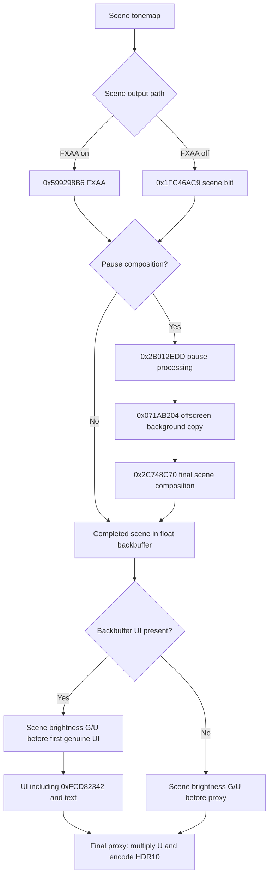

# Red Dead Redemption 2

Use Vulkan with **Windows HDR enabled** and **HDR disabled in the game's settings**. When upgrading from the previous `rdr2vk`, **reset existing RenoDX presets**: tone mapper numbering and grading behavior have changed.

## Tonemapping

The mod replaces the SDR tone curve while the scene still contains HDR detail, carries that range through upgraded render textures, and encodes HDR10 only at the final output. It does not inverse-tonemap a completed SDR frame. Game exposure, bloom, vignette, grading masks, and LUT sampling remain in the processing chain.

The main scene variants use two hooks in `tonemap/tonemap.glsl`:

1. **`ApplyToneMap()`**, before the game's SDR encoding and LUTs, selects the original curve, its extension, or an anchor-scaled scene signal for PsychoV.
2. **`ApplyFinalToneMap()`**, after the game's LUTs and dithering, decodes the result, applies mode-specific display mapping and optional film grain, then writes sRGB-encoded BT.709 for subsequent game passes.

| Mode | Setup |
|---|---|
| **Vanilla / 0** | Keeps the original SDR curve and output clamp; bypasses custom final grading and grain. Output still uses the HDR10 proxy. |
| **Vanilla+ / 1** | Extends the original curve above its inflection point with a matching tangent. After LUT processing, applies anchored tonal grading, finite-clip C-infinity rolloff, then anchored saturation grading. |
| **PsychoV / 2** — default | Replaces the curve with an anchor-scaled scene signal, then decodes the game's sRGB-like encoding before applying a customized version of PsychoV31. Input/output anchors and logarithmic contrast derive from the vanilla inflection value and slope. Baseline toe/contrast tuning approximates the vanilla gamma-2.2 display appearance with less shadow crush. |

Vanilla+ grading and rolloff share the linear BT.709 anchor `0.07207985`. Its saturation controls operate in Stockman/CVRL LMS and preserve physiological Yf; highlight detection uses the color before tonal grading. PsychoV handles those controls internally. Both custom modes target `Peak Brightness / Game Brightness` with a finite shoulder clip of `100` in their respective working domains; this is not a final-output hard cap after saturation and effects.

### LUTs and effects

- **LUT bridge (custom modes):** gamma-2.2 decode, max-channel C-infinity compression into SDR range, then re-encode for unchanged packed-LUT sampling and masks. The sampled result is decoded, inverse-scaled, blended by LUT Strength, and re-encoded; zero strength returns the pre-LUT color directly.
- **Weapon wheel:** compresses scene highlights before bounded tint/noise processing and restores their scale before the LUT bridge. This path uses nonnegative RGB.
- **Film grain:** regular BT.709 grain runs after custom display mapping, using normalized scene UVs.
- **Match Vanilla:** selects Vanilla+, resets grading, restores original dithering, and disables added grain. **Preset Off** instead selects Vanilla and restores the original lighting clamp. Both reset game/UI brightness and EOTF settings; Peak Brightness is retained.

## Scene and UI brightness

### Rendering-path contract

The arrows below describe GPU content order, not CPU recording timestamps. `0xFCD82342` is UI in every path; offscreen UI rendering never establishes scene output. `0x2C748C70` is scene composition, including its nonlinear overlay operation. Do not move scaling into its inputs or turn the background copy into a UI boundary.

Regression requirements: preserve FXAA-on gameplay and pause composition when correcting the FXAA-off blit; preserve FXAA-off when changing pause classification. A recorded scene followed by UI is valid, including when merged from a secondary list. Actual scene writes after UI remain unsupported and must not be hidden by removing the ordering guard. Menu-only output has no scene normalization; equal Game/UI Brightness skips the normalization work. Verify independent sliders in gameplay, pause, weapon wheel, and HUD-hidden gameplay with FXAA both on and off. A successful build is not runtime verification.

Let `G` be Game Brightness and `U` be UI Brightness. Immediately before the first known backbuffer UI draw, one fullscreen pass decodes the completed scene, multiplies RGB by **`G / U`**, and re-encodes without changing alpha. It reads a full-resolution RGBA16F copy of the float backbuffer clone and writes back into that clone. Negative RGB and values above one are preserved. The final proxy scales the composite by **`U`** and converts to BT.2020/PQ. UI colors and encoded-space blending remain unchanged.

Scene scaling and the proxy use gamma 2.2 when SDR EOTF Emulation is enabled, otherwise sRGB. PsychoV forces that setting off. UI finalization only preserves the existing nonnegative RGB and bounded-alpha behavior; it does not scale brightness.

All UI replacements use `CustomSwapchainShader` gates. Boundary tracking additionally checks the actual bound image against the tracked backbuffer or its float clone and requires RGB color writes. Offscreen, stencil-only, and alpha-only draws do not finish the scene. This includes scene/stencil reuse of `0x712840D6` and offscreen use of generic fill `0x096D7C1F`. Unknown color-write state blocks the no-UI fallback rather than treating possible UI as a clean scene. The scene-blit and FXAA shaders keep their vanilla math; the weapon-wheel shader retains its HDR bridge but no longer scales brightness.

Scene/UI evidence belongs to each command-list recording and acquired backbuffer generation. A new generation begins only after successful image acquisition, including `VK_SUBOPTIMAL_KHR`; presentation does not reset a CPU-frame latch. The known FXAA scene output marks its completed backbuffer write even if the tonemap was recorded in another command list. The generic `0x1FC46AC9` blit instead resolves its actual sampled resource at binding 186, set 1, against known scene outputs in submission order. It does not require the producer to have been recorded in the same command list, and an unmatched menu input does not establish scene output. Producer evidence commits only on successful submission and clears on acquisition. A submitted scene without backbuffer UI uses the pass immediately before the output proxy, provided its image state is known. Offscreen UI draws do not suppress this fallback.

Pause background composition through `0x2C748C70` is part of the scene. FXAA, pause processing, the offscreen `0x071AB204` background copy, and `0x2C748C70` composition all run before scene brightness normalization. Scaling starts only before subsequent genuine backbuffer UI, or at the no-UI fallback. This preserves the compositor's nonlinear overlay math rather than scaling its inputs prematurely. Neither shader body is changed, and no offscreen capture or descriptor-history tracking is required.

Each eligible command list records the brightness pass before its first backbuffer UI color draw, even if the scene has not been recorded yet. One existing RenoDX renderer per backbuffer handles every recording. The shader reads one `ShaderInjectData` cbuffer defined in `shared.h`, including `scene_brightness_enabled`; there is no second brightness/control cbuffer or duplicate settings push-constant block. Each recording owns an upload of that shared data because submission order, not recording order, selects the pass. Menu-only and later-UI passes discard every fragment. Equal brightness records boundary evidence without a copy, draw, or upload allocation.

Narrow game-local hooks forward Vulkan acquisition, command-buffer begin, and queue-submit calls unchanged. Begin flags exclude inherited and simultaneous-use recordings; an actual render-pass begin identifies a suspendable pass. Submission records commit only after `VK_SUCCESS`, not as a claim of GPU completion. Mapped shared-data uploads are reused only with the application's nonpending command-list recording and freed with that list. Acquisition does not touch GPU data because it can precede the semaphore signal. The no-UI fallback records its shared-data upload on the GPU instead of overwriting mapped memory that an earlier frame may still read. No submission arrays, semaphores, queue waits, or flush behavior are changed.

The pre-UI path requires stored color/depth attachments, no active queries, and Vulkan push-descriptor support. It resumes attachments with LOAD and restores graphics state. Inherited and simultaneous-use passes are not interrupted; secondary evidence is merged for submission validation. A missing brightness pass, stale acquisition, late scene write, or queue change rejects separation for that acquisition with a bounded diagnostic. GPU resource/rendering failures remain latched until recreation. Compile-time ordering checks are not runtime proof; the fresh-save-to-HUD transition and third-party upscalers still require in-game verification. No HUDless output or frame-generation integration is included.

## Resource and proxy lifetime

The NVIDIA-only R11G11B10-to-RGBA16F rule directly upgrades backbuffer-sized render textures. A separate RGBA16F backbuffer clone preserves the scene/UI composite until HDR10 encoding; this is not a clone of every scene texture. Automatic cloning and compatibility backbuffer copying remain disabled.

`swapchain_proxy.hpp` owns the existing RenoDX output and brightness renderers per backbuffer, plus their scratch image, views, and fallback upload. Command lists own only shared-data uploads, not extra renderers, image views, pipelines, or descriptor sets. Image and cbuffer bindings are pushed directly, so brightness does not consume ReShade's limited descriptor-set pool. The shared resource machinery still owns the clones. With unequal brightness, every eligible UI list costs a full-resolution scratch copy and draw; only the selected pass changes RGB. Equal brightness skips both operations. There is no original-UNORM compatibility copy, per-frame queue wait, or clone-creation retry.

Recreation replaces the pass state even when Vulkan reuses the swapchain object with `resize == false`. Retirement drains the recorded presentation queue outside local locks before destroying GPU pass objects. Clone initialization failure prevents publishing the new state; later clone or rendering failures are logged once per affected backbuffer and held until recreation. Errors go to `ReShade.log`; a failed output pass is not an SDR fallback.

`resource_fixes.hpp` preserves deferred clone passes that end without a draw, including load-operation clears for black transition frames. This repair applies to builds targeting ReShade add-on API versions below 20, selected by the SDK headers at compile time rather than the installed runtime. It also converts supported mismatched Vulkan region copies involving direct upgrades when neither endpoint uses clone redirection; shared clone-copy handling remains unchanged. Conversion does not upgrade the destination or restore range lost to a lower-range format, and the fixes do not broaden resource-upgrade matching.

### Verification

Current runtime coverage: independent scene/UI brightness was reported working across multiple tone mapper types after the FXAA-off source-provenance correction; FXAA-on and pause behavior were also reported working during development. MSAA is **untested** and is not a release blocker for this change. These reports do not establish complete lifecycle or third-party upscaler compatibility. The final ordering/lifetime audit changes still require a runtime smoke test.

- Close RDR2, build target `rdr2vk`, and inspect `build/Release/renodx-rdr2vk.addon64` for the Release configuration; do not rebuild a loaded addon.
- Check unequal Game/UI Brightness in gameplay, FXAA, MSAA, the weapon wheel, pause/map, menu/video, and HUD-disabled gameplay. Change each brightness slider independently and compare with equal values; verify alpha edges, stencil clipping, signed colors, and highlights remain correct.
- Start with a freshly loaded save before pressing any gameplay button, then reveal the HUD. Game Brightness must continue controlling the scene, UI Brightness must affect only the HUD, and `ReShade.log` must contain no lifecycle-hook, brightness-pass, missing-brightness, or stale-acquisition error. Repeat HUD hide/show and menu-to-game transitions without recreating the swapchain.
- Test repeated Alt-Tab out/back and minimize/restore in gameplay, pause, map, and menu/video, followed by resolution and fullscreen/borderless changes.
- Toggle VSync in both directions, then change Reflex and buffering settings. Confirm rendering and unequal Game/UI Brightness remain correct after each recreation.
- Verify sleeping/waking fades and loading-to-game transitions remain correct, without stale frames or flashes.
- Check `ReShade.log` for `rdr2vk` errors, including unsupported scene/UI ordering, and watch memory across repeated identical transitions. Test first without DevKit/ReShade effects, then with the normal overlay stack; compilation alone does not verify runtime stability.